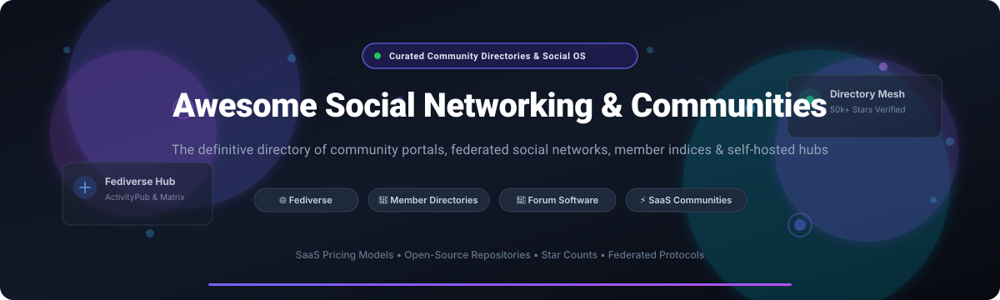

<p align="center">
  
</p>

# Awesome Social Networking & Community Directories 🌐👥

<p align="center">
  <a href="https://github.com/ishandutta2007/Awesome-Awesome-Awesome"></a>
  <a href="https://discord.gg/jc4xtF58Ve"></a>
  <a href="https://github.com/ishandutta2007/Awesome-Social-Networking-Community-Directories/stargazers"></a>
  <a href="https://github.com/ishandutta2007/Awesome-Social-Networking-Community-Directories/network/members"></a>
  <a href="https://github.com/ishandutta2007/Awesome-Social-Networking-Community-Directories/blob/main/LICENSE"></a>
  <a href="https://github.com/ishandutta2007"></a>
</p>

---

## 📖 Executive Summary & SEO Overview

Welcome to the **definitive curated index of Social Networking platforms, Community Portals, and Member Directories**. Whether you are architecting a university alumni network, scaling a customer engagement ecosystem, building developer relations hubs, or self-hosting sovereign federated social spaces with ActivityPub or Matrix, this directory connects you to top-tier commercial SaaS solutions and battle-tested open-source repositories.

### 🔍 Key Focus Areas:
- 🏛️ **Searchable Member Directories & Portals**: Geolocation directories, verified profile catalogs, member onboarding, and granular access controls.
- 💬 **Discussion Forums & Modern Bulletin Boards**: High-performance community discussion engines, trust-level reputation systems, and threading.
- 🌐 **Federated Social Networks & Fediverse Nodes**: ActivityPub, AT Protocol, and Matrix decentralization engines for data sovereignty.
- ⚡ **Real-Time Group Messaging & Agent Hubs**: Chat rooms, voice spaces, topic channels, and multi-agent workspace feeds.

---

## 📊 Sector Overview & Market Dynamics

The global online community and social engagement software market is estimated at **$3.8 billion to $5.2 billion (2025–2026)** and is projected to expand at a **Compound Annual Growth Rate (CAGR) of 11.5% to 14.2%**, eclipsing **$10 billion by 2031**. 

### 🧩 Market Dynamics:
- **Hybrid Structure (Bifurcated Concentration)**: The sector exhibits **moderate fragmentation at the mid-market and creator tier** (with specialized platforms like Circle.so, Mighty Networks, and Bettermode competing fiercely on modularity, course delivery, and UI craft), while remaining **highly concentrated at the enterprise scale** where incumbent suites (Salesforce Experience Cloud, Slack, and Khoros) dominate customer support and compliance-sensitive implementations.
- **Rise of Sovereign & Federated Infrastructure**: Rapidly expanding interest in data ownership, GDPR governance, and vendor independence has spurred accelerated enterprise adoption of open-source ActivityPub, Matrix, and self-hosted SSO frameworks (Discourse, Mastodon, Mattermost, Authentik).

---

## 📑 Table of Contents
- [📖 Executive Summary & SEO Overview](#-executive-summary--seo-overview)
- [📊 Sector Overview & Market Dynamics](#-sector-overview--market-dynamics)
- [☁️ SaaS / Hosted Community Platforms](#️-saas--hosted-community-platforms)
- [💻 Open-Source GitHub Projects](#-open-source-github-projects)
- [🛠️ Architectural Blueprints & Tech Stacks](#️-architectural-blueprints--tech-stacks)
- [🤝 How to Contribute](#-how-to-contribute)
- [💖 Support](#-support)
- [📈 Star History](#-star-history)
- [⚖️ Disclaimer & Compliance](#️-disclaimer--compliance)

---

## ☁️ SaaS / Hosted Community Platforms

Commercial community platforms and hosted directories ranked in descending order by estimated company size (market valuation / revenue scale):

| 🏢 Platform | 💰 Company Valuation / Revenue Scale | 🏷️ Starting Paid Tier | 🎁 Free Tier Limits & Trial Specifications | 🌟 Key Strengths & Directory Capabilities |
| :--- | :--- | :--- | :--- | :--- |
| **[Slack Communities](https://slack.com)** | **$27.7B Valuation** *(Salesforce acquisition; ~$1.5B+ ARR)* | **$7.25 / user / month** *(Pro, billed annually)* | **Free Forever Plan**: 90-day search/viewable history (rolling auto-purge after 1 year), 10 third-party app integrations, 1:1 huddles (capped at 30 minutes), 1:1 external Slack Connect DMs, and 1 GB upload cap. | Enterprise-grade peer directories, real-time channels, native audio/video huddles, Canvas wikis, and deep enterprise SSO integrations. |
| **[Reddit Pro](https://reddit.com)** | **~$16B – $17.5B Market Cap** *(NYSE: RDDT; $2.2B+ ARR)* | **$0.00 / month** *(Organic toolkit is 100% free; separate paid ad campaigns available)* | **Free Forever Plan**: Full access to organic business profiles, Reddit Pro Trends keyword tracking, audience & subreddit insights, scheduled posting, and sentiment analytics. | Massive global reach, discovery across thousands of subreddit topic hubs, keyword social listening, and verified corporate brand identities. |
| **[Discord Communities](https://discord.com)** | **~$9B – $10B Valuation** *(Pre-IPO estimate; ~$600M – $725M+ ARR)* | **$2.99 / month** *(Nitro Basic) or $9.99/mo (Nitro)* | **Free Forever Plan**: Join up to 100 community servers, unlimited audio/video stages, 2,000-character messages, community forum channels, screen share (720p/30fps), and 10–20 MB file attachment cap. | High-concurrency voice/video hangouts, topic server directories, onboarding verification flows, forum channels, and developer bots. |
| **[Circle (Circle.so)](https://circle.so)** | **~$200M – $250M Valuation** *(Series A; ~$20M+ ARR)* | **$89 / month** *(Professional, billed annually + 2% transaction fee)* | **14-Day Free Trial** (no credit card required upfront; preview core community spaces, directory profiles, courses, and 2,500 AI credits). No free forever plan. | Modern all-in-one creator & brand hubs, searchable member directory catalogs, integrated paywalls, courses, live streaming, and automated workflows. |
| **[Mighty Networks](https://mightynetworks.com)** | **~$200M Valuation** *(Series B; $68M venture funding raised)* | **$79 / month** *(Launch, billed annually + 2% transaction fee)* | **14-Day Free Trial** (no credit card required; full sandbox access to spaces, member directories, native video/livestreaming, and course authoring). No free forever plan. | Branded community portals, geolocation member matching, interactive feeds, events ticketing, and customizable white-label iOS/Android apps. |
| **[Hivebrite](https://hivebrite.com)** | **~$100M – $250M Valuation** *(~$37M Series B; ~$20M ARR)* | **~$895 / month** *(~$10,700/year base entry; billed strictly annually)* | **No Self-Serve Free Trial**: Enterprise platform access requires a scheduled sales demonstration and qualification process. | Enterprise and university alumni directory management, interactive global member maps, sub-chapters, job boards, and bi-directional CRM sync. |
| **[Bettermode](https://bettermode.com)** | **~$40M – $80M Valuation** *($13M+ venture funding raised)* | **$149 / month** *(Starter, billed annually; or $199 month-to-month)* | **14-Day Free Trial** (no credit card required; test layout visual customizer, apps, and member profiles). Note: legacy free tier has been phased out. | Modular customer engagement hubs, custom profile fields, product ideation boards, knowledge base Q&A, and enterprise SSO embeddability. |
| **[Guilded](https://guilded.gg)** | **Roblox Subsidiary** *(Acquired by Roblox Corp - $30B+ Parent Market Cap)* | **$0.00 / month** *(All platform features free; 2.5% cut only on server subscription payouts)* | **Free Forever Plan**: Unlimited 1080p/60fps streams, high-bitrate voice, full server organization, calendar scheduling, forum channels, and custom roles. (Roblox account link required). | Discord alternative tailored for teams and gaming organizations with built-in recruitment applications, tournament trees, and scheduling docs. |
| **[Geneva](https://geneva.com)** | **Bumble Subsidiary** *(Acquired by Bumble Inc - $1.2B Parent Market Cap)* | **$0.00 / month** *(Integrated into Bumble BFF group features)* | **Free Forever Plan**: Group chats, broadcast audio rooms, calendar RSVPs, and topic directories (freely accessible across mobile and desktop apps). | Intimate club-style community spaces, mobile-first social hubs, calendar integration, and casual multi-room group coordination. |

---

## 💻 Open-Source GitHub Projects

Self-hosted community platforms, decentralized federated protocols, and member directories sorted in descending order by GitHub stargazers count:

| 📦 Repository | 🌟 Stargazers Badge | 🛠️ Tech Stack & Architecture | 📝 Description & Directory Highlights |
| :--- | :---: | :--- | :--- |
| **[Mastodon](https://github.com/mastodon/mastodon)** | [](https://github.com/mastodon/mastodon/stargazers) | Ruby on Rails, Node.js, PostgreSQL, Redis | Sovereign, decentralized microblogging network implementing the W3C ActivityPub protocol with opt-in federated member directories. |
| **[Discourse](https://github.com/discourse/discourse)** | [](https://github.com/discourse/discourse/stargazers) | Ruby on Rails, Ember.js, PostgreSQL, Redis | The gold standard open-source community discussion forum featuring user trust levels, searchable member lists, badging, and extensive API webhooks. |
| **[Rocket.Chat](https://github.com/RocketChat/Rocket.Chat)** | [](https://github.com/RocketChat/Rocket.Chat/stargazers) | TypeScript, Node.js, MongoDB, WebRTC | Secure, privacy-first communication platform for omnichannel messaging, federated matrix bridges, team chat, and member profile management. |
| **[Chatwoot](https://github.com/chatwoot/chatwoot)** | [](https://github.com/chatwoot/chatwoot/stargazers) | Ruby on Rails, Vue.js, PostgreSQL, Redis | Open-source customer engagement and conversational portal providing shared inboxes, member contact directories, and live community chat widgets. |
| **[Mattermost](https://github.com/mattermost/mattermost)** | [](https://github.com/mattermost/mattermost/stargazers) | Go, React, PostgreSQL/MySQL | High-trust enterprise team collaboration and developer community hub with threaded channels, user directory lookups, and Playbook workflows. |
| **[Keycloak](https://github.com/keycloak/keycloak)** | [](https://github.com/keycloak/keycloak/stargazers) | Java, Quarkus, WildFly, OAuth2/OIDC | Enterprise identity and access management (IAM) server powering single sign-on (SSO), user federation, and centralized member directory backends. |
| **[Authentik](https://github.com/goauthentik/authentik)** | [](https://github.com/goauthentik/authentik/stargazers) | Python, Go, React, PostgreSQL | Versatile, modern identity provider and directory federation server engineered to unify SSO across self-hosted forums, wikis, and chat networks. |
| **[Zulip](https://github.com/zulip/zulip)** | [](https://github.com/zulip/zulip/stargazers) | Python, Django, TypeScript, PostgreSQL | Unique stream and topic-threaded real-time chat platform engineered for productive asynchronous discussion and searchable user directories. |
| **[Forem](https://github.com/forem/forem)** | [](https://github.com/forem/forem/stargazers) | Ruby on Rails, Preact, PostgreSQL, Redis | Open-source publishing and networking software powering Dev.to, built for creator networks, tag-based directories, and member portfolios. |
| **[NodeBB](https://github.com/NodeBB/NodeBB)** | [](https://github.com/NodeBB/NodeBB/stargazers) | Node.js, Socket.IO, Redis/MongoDB | Fast, modern forum engine with real-time streaming notifications, comprehensive user directories, REST APIs, and plugin extensibility. |
| **[Lemmy](https://github.com/LemmyNet/lemmy)** | [](https://github.com/LemmyNet/lemmy/stargazers) | Rust, Actix-web, Diesel, PostgreSQL | Federated link aggregation and community discussion platform interoperable with Mastodon and the broader Fediverse via ActivityPub. |
| **[Element Web](https://github.com/element-hq/element-web)** | [](https://github.com/element-hq/element-web/stargazers) | TypeScript, React, Matrix Protocol | Flagship secure collaboration web client for Matrix featuring decentralized public room discovery, community Spaces, and end-to-end encryption. |
| **[Matrix Synapse](https://github.com/matrix-org/synapse)** | [](https://github.com/matrix-org/synapse/stargazers) | Python, Twisted, PostgreSQL | The reference homeserver implementation for the Matrix protocol, providing federated identity, directory synchronization, and encrypted rooms. |
| **[Owncast](https://github.com/owncast/owncast)** | [](https://github.com/owncast/owncast/stargazers) | Go, Preact, SQLite | Self-hosted live video streaming server and interactive community chat room featuring ActivityPub fediverse bot integration. |
| **[Misskey](https://github.com/misskey-dev/misskey)** | [](https://github.com/misskey-dev/misskey/stargazers) | TypeScript, Node.js, Vue.js, PostgreSQL | Highly customizable ActivityPub decentralized microblogging platform featuring custom emoji reactions, drive storage, and timeline channels. |
| **[AT Protocol](https://github.com/bluesky-social/atproto)** | [](https://github.com/bluesky-social/atproto/stargazers) | TypeScript, Go, Lexicon schemas | Open-source decentralized social networking protocol created by Bluesky, decoupling user identity, content hosting, and algorithmic feeds. |
| **[HumHub](https://github.com/humhub/humhub)** | [](https://github.com/humhub/humhub/stargazers) | PHP, Yii Framework, MySQL | Modular social networking kit and enterprise intranet featuring rich member directories, user spaces, calendar modules, and activity walls. |
| **[Flarum](https://github.com/flarum/framework)** | [](https://github.com/flarum/framework/stargazers) | PHP, Mithril.js, MySQL | Delightfully simple, fast discussion software featuring smooth infinite scroll, two-pane layouts, member listings, and an active extension ecosystem. |
| **[WriteFreely](https://github.com/writefreely/writefreely)** | [](https://github.com/writefreely/writefreely/stargazers) | Go, SQLite/MySQL, ActivityPub | Minimalist, federated blogging and writing platform designed for community publishing networks and shared writer directories. |
| **[Revolt / Stoat](https://github.com/stoatchat/stoatchat)** | [](https://github.com/stoatchat/stoatchat/stargazers) | Rust, TypeScript, MongoDB, Redis | Privacy-first, open-source community chat and voice server built as a self-hostable Discord alternative without corporate tracking. |
| **[phpBB](https://github.com/phpbb/phpbb)** | [](https://github.com/phpbb/phpbb/stargazers) | PHP, Symfony components, MySQL/Postgres | Historic, robust open-source bulletin board package featuring battle-tested member directories, permission matrices, and custom profile fields. |
| **[Decidim](https://github.com/decidim/decidim)** | [](https://github.com/decidim/decidim/stargazers) | Ruby on Rails, PostgreSQL | The open-source participatory democracy platform for civic communities, councils, and cooperatives to host member assemblies and voting. |
| **[Elgg](https://github.com/Elgg/Elgg)** | [](https://github.com/Elgg/Elgg/stargazers) | PHP, MySQL, JavaScript | Extensible social engine providing low-level data modeling primitives for custom social networks, student portfolios, and community directories. |
| **[Consul Democracy](https://github.com/consuldemocracy/consuldemocracy)** | [](https://github.com/consuldemocracy/consuldemocracy/stargazers) | Ruby on Rails, PostgreSQL | Citizen participation and institutional community engagement tool facilitating participatory budgeting, debates, and voting processes. |
| **[MyBB](https://github.com/mybb/mybb)** | [](https://github.com/mybb/mybb/stargazers) | PHP, MySQL/PostgreSQL | Classic, lightweight forum software with reputation systems, user group hierarchies, directory management, and extensive theme support. |
| **[Bonfire](https://github.com/bonfire-networks/bonfire-app)** | [](https://github.com/bonfire-networks/bonfire-app/stargazers) | Elixir, Phoenix, Ash, ActivityPub | Modular, federated framework empowering users to tailor their social spaces, customize member directory boundaries, and control data feeds. |
| **[Open Collective](https://github.com/opencollective/opencollective-frontend)** | [](https://github.com/opencollective/opencollective-frontend/stargazers) | Next.js, React, GraphQL, PostgreSQL | Transparent fundraising and community fiscal hosting platform displaying public contributor directories, expense budgets, and backers. |
| **[BuddyPress](https://github.com/buddypress/buddypress)** | [](https://github.com/buddypress/buddypress/stargazers) | PHP, WordPress | WordPress community engine adding searchable member directories, activity streams, user groups, and private messaging to any WP site. |
| **[Flockbook](https://github.com/minchenlee/flockbook)** | [](https://github.com/minchenlee/flockbook/stargazers) | Swift, TypeScript, Node.js | Native macOS reading view and community feed for Herdr to monitor, read, and converse with local autonomous coding agents in one unified hub. |

---

## 🛠️ Architectural Blueprints & Tech Stacks

When engineering a modern community architecture, organizations frequently compose distinct open-source modules:

```
┌─────────────────────────────────────────────────────────────┐
│                    Unified Identity & SSO                   │
│          (Authentik / Keycloak / OpenID Connect)            │
└──────────────────────────────┬──────────────────────────────┘
                               │
       ┌───────────────────────┼────────────────────────┐
       │                       │                        │
       ▼                       ▼                        ▼
┌──────────────┐       ┌──────────────┐         ┌──────────────┐
│  Searchable  │       │ Asynchronous │         │  Real-Time   │
│  Directory   │       │ Discussions  │         │ Collaboration│
│  (HumHub /   │       │ (Discourse / │         │   (Zulip /   │
│  BuddyPress) │       │   Flarum)    │         │ Rocket.Chat) │
└──────────────┘       └──────────────┘         └──────────────┘
```

- **Alumni & Membership Directories**: Combine **Authentik** for directory SSO with **HumHub** or **Forem** for structured member profiles, user search, and skill tags.
- **Developer & Open-Source Hubs**: Pair **Discourse** for indexed problem-solving and knowledge retention with **Zulip** or **Element (Matrix)** for daily real-time discussions.
- **Decentralized Fediverse Networks**: Run **Mastodon** or **Lemmy** instances communicating over ActivityPub to give community members portable identities and global cross-instance visibility.

---

## 🤝 How to Contribute

Contributions are warmly welcomed! Help keep this ecosystem guide complete, accurate, and up-to-date:

1. **Fork the repository** to your GitHub account.
2. **Add or refine listings** in `README.md` following the established table structure.
3. **Verify requirements**:
   - Provide exact starting tier prices and explicit free tier / trial parameters for SaaS products.
   - Include official GitHub repository URLs with valid stargazer counts for open-source tools.
4. **Submit a Pull Request** with a concise description of your changes.

Star the repository if you find it helpful! ⭐

---

## 💖 Support

If you find this directory valuable for your organization, research, or development projects, please consider supporting the project:

- ⭐ **Star this repository** to help others discover it across GitHub.
- 🍴 **Fork and share** with your network, engineering team, or community builders.
- ☕ **Sponsor & Buy a Coffee**: Support ongoing maintenance and curated updates via the [GitHub Sponsors Dashboard](https://github.com/sponsors/ishandutta2007).

---

## 📈 Star History

## Star History
#[](https://star-history.dera.page/#ishandutta2007/Awesome-Social-Networking-Community-Directories&type=date&legend=top-left)`
[](https://www.star-history.com/#ishandutta2007/Awesome-Social-Networking-Community-Directories&type=date&legend=top-left)`

---

## ⚖️ Disclaimer & Compliance

- This repository is a **community-curated index** published for informational, architectural, and educational purposes. Inclusion does not imply commercial endorsement.
- **Privacy & GDPR Compliance**: Community portals and directories handle personal identifiable information (PII). Ensure appropriate data processing agreements, opt-in privacy controls, encryption in transit/at rest, and GDPR/CCPA compliance when deploying member directories.
- **Agent Safety**: When running agent integration software (such as `minchenlee/flockbook`), review code permissions and security policies before granting local file system or execution privileges.

---

<p align="center">
  <sub>Maintained with ❤️ for community leaders, open-source maintainers, and decentralized web architects worldwide.</sub>
</p>
